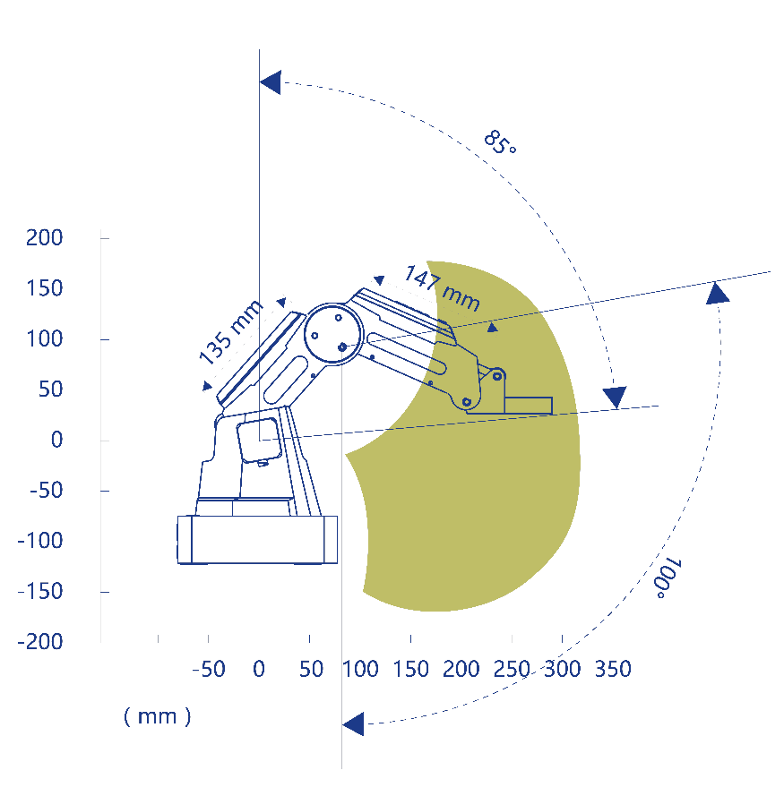
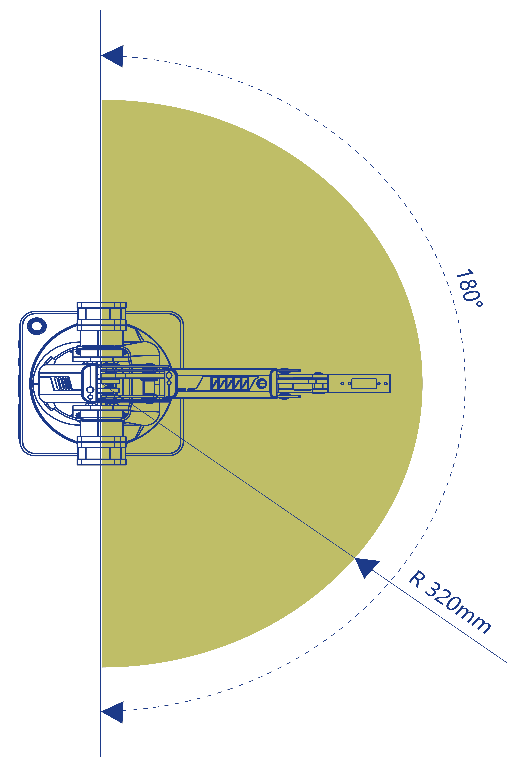

# Workspace

Physical limits of the Dobot Magician, from sections 2.3 and 2.4 of the [Dobot Magician V2 User Guide (DobotLab-based) V2.3.1](../Dobot-Magician-V2-User-Guide-V2.3.1.pdf).

## Specifications

| Item | Value |
|---|---|
| Base (J1) | -90° to +90° |
| Rear arm (J2) | 0° to 85° |
| Forearm (J3) | -10° to +90° |
| End-effector rotation (J4) | -90° to +90° |
| Rear arm length | 135 mm |
| Forearm length | 147 mm |
| Maximum reach | 320 mm |
| Maximum payload | 500 g |
| Repeated positioning accuracy | 0.2 mm |

## Coordinate system

The origin is the center of the base, rear-arm, and forearm motors. X points forward, Y to the left, and Z up. R is the rotation of the end-effector servo and exists only when an end effector with a servo, such as the suction cup or the gripper, is installed.

## Reachable region

The base turns 90° to each side, so targets behind the base (x < 0) are out of reach. The range of reachable heights depends on the horizontal distance from the base axis.

{ width="420" }
{ width="250" }

Side view (Figure 2.2) and top view (Figure 2.3) of the user guide. Dimensions in mm.

## Targets out of reach

A target out of reach sets a planning alarm such as `PLAN_MOTION_TARGET_OUT_OF_WORKSPACE` or `PLAN_INVERSE_LIMIT`, and [`ptp`](../api/motion.md#ptp) raises [`DobotKinematicError`](../api/errors.md#dobotkinematicerror). A joint at its limit sets a `LIMIT_POS_J*` or `LIMIT_NEG_J*` alarm. See [Alarm bitmask](../protocol/alarms.md) and [Alarms and recovery](alarms.md).

The [simulator](../api/simulator.md) applies the joint ranges and arm lengths to point-to-point targets. It does not limit jogging.
